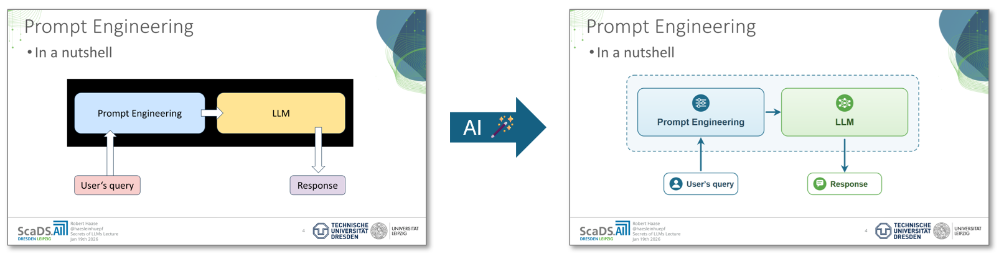

# polish-pptx

CLI tool that polishes pptx slides containing multiple arrows, boxes, circles etc. using Claude AI.



Each such slide is rendered (`render-pptx`), sent to Claude, which returns a polished
SVG of the figure; the SVG is rasterized to PNG, cropped to its content and added to the slide (with the content at the
same position and scale it had in the uncropped PNG, fitted and centered on the slide).
All other shapes on that slide, except the headline and the main text shape, are moved down by one
slide height, so they sit below the slide (not visible, but still available for editing).
The 3 most recently polished slides of a run are sent along as few-shot examples, so similar
slides get the same style and icons.

## Installation

For using this tool, you need an [Anthropic Claude API key](https://platform.claude.com/settings/keys) stored as `ANTHROPIC_API_KEY` environment variable.

```
pip install polish-pptx
```

## Usage
```
polish-pptx deck.pptx --slides 4,5     # writes deck.pptx.polished.pptx
```

## Options

* `--model` The Anthropic Claude model to use (default `claude-sonnet-5-5`).  
* `--min-shapes` The criterion to select slides, must have at lest n shapes (default 3).
* `--slides` A comma-separated list of slide numbers to polish, e.g. `--slides 1,3,5` (optional, overrides `--min-shapes`).
